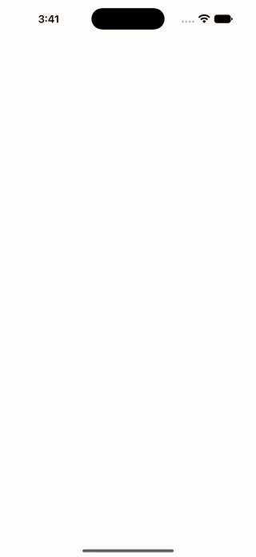

# Minted
Turn any SVG into a physically-lit 3D gold medallion for SwiftUI with cloisonne enamel, engraved lettering and momentum spins, and no 3D assets.

<p align="center">
  
</p>

<p align="center">
  
  
  [](https://github.com/haplollc/Minted/stargazers)
  [](LICENSE)
</p>

<p align="center">
  <a href="https://buymeacoffee.com/jcbuilds"></a>
  <br>
  <sub>If Minted is useful to you, a coffee keeps it going.</sub>
</p>

**Install**

```swift
dependencies: [
    .package(url: "https://github.com/haplollc/Minted", from: "1.0.0")
]
```

**Try it**

```swift
import Minted

let heart = CoinDesign(svgPathData: "M12 21s-6.7-4.35-9.33-8.11 ...")!

SpinningCoinView(design: heart)
    .frame(width: 300, height: 300)
```

If this is useful, a star helps others find it.

---

## Why

Achievement badges, collectibles, loyalty stamps, awards: they all want to feel like *things*. Minted takes flat vector art you already have and strikes it into a solid gold coin with glossy enamel inlays, real studio reflections that sweep across the metal as it turns, and a die-struck orange-peel back. Everything is generated geometry from your 2D paths, so your app ships zero model files.

## Installation

In Xcode: **File > Add Package Dependencies** and paste

```
https://github.com/haplollc/Minted
```

Or in `Package.swift`:

```swift
dependencies: [
    .package(url: "https://github.com/haplollc/Minted", from: "1.0.0")
]
```

## Two ways in

**You have finished pin artwork.** Hand Minted the image and it does the rest:
the artwork becomes the coin's face, the outline is traced from the image, and
the gold in the art is detected and rendered as real metal.

```swift
let coin = try ArtworkCoin(image: UIImage(named: "eiffel-pin")!)

SpinningArtworkCoinView(coin: coin)
    .frame(width: 300, height: 300)
```

That is the whole integration. A new pin means a new PNG and nothing else.
Six sample pins ship with the package if you want to see it work first:

```swift
let coin = try ArtworkCoin(sample: .alhambra)
```

**You want to build a coin from vectors.** Use `CoinDesign`, which composes a
coin out of silhouette, enamel, and engraving. Read on for that.

## Mint your first coin

Three lines from SVG path data to a spinning medallion:

```swift
import Minted

let heart = CoinDesign(svgPathData: "M12 21s-6.7-4.35-9.33-8.11 ...")!

SpinningCoinView(design: heart)   // idles in a slow spin; drag to flick it
    .frame(width: 300, height: 300)
```

Have a whole SVG file? Hand it over and every `<path>` inside is merged and placed via the viewBox:

```swift
let logo = CoinDesign(svgFileData: try Data(contentsOf: fileURL))!
```

Or skip SVG entirely and mint any `CGPath` or SwiftUI `Path`:

```swift
let starburst = CoinDesign(art: Path(ellipseIn: CGRect(x: 0, y: 0, width: 1, height: 1)))
```

## Make it yours

Every knob has a sensible default, so you add only what you want:

```swift
let award = CoinDesign(
    svgPathData: trophySVG,
    silhouette: .seal,                 // .seal, .octagon, .circle, .diamond, .custom(CGPath)
    palette: CoinPalette(
        field: .systemIndigo,          // the petals behind the art
        art: .white                    // the art's enamel
    ),
    engraving: .petals,                // .petals, .rays, .lattice, .plain
    topText: "EMPLOYEE",               // engraved along the crown
    bottomText: "OF THE MONTH"         // engraved along the base
)!
```

Two-tone art, like a snow-capped mountain:

```swift
CoinPalette(art: .white, artLower: .systemBlue, artSplit: 0.34)
```

Shape the outline and pick the metal. A `.custom` silhouette takes any `CGPath`
in the normalized 0...1, y-down square, and `CoinPalette(gold:)` sets the metal
everywhere the coin is gold:

```swift
let crest = CoinDesign(
    svgPathData: crestSVG,
    silhouette: .custom(shieldPath),          // any CGPath in the normalized 0...1 y-down square
    palette: CoinPalette(gold: .systemTeal)   // the metal: body, rim, wire, engraving
)!
```

`gold` defaults to `CoinPalette.roseGold`; `field` and `art` stay enamel either way.

## Grids and stills

Live SceneKit views are for hero moments. For a grid of coins, use the
snapshot pipeline: it renders each design once, off the main thread, and
caches to disk.

```swift
CoinThumbnailView(design: award, size: 120)
```

Need the image itself (for sharing, notifications, widgets)?

```swift
let image = await CoinSnapshotter.shared.snapshot(design: award, pixelSize: 1024)
```

And for locked or unearned states, the same design as quiet line work:

```swift
CoinLineArt(design: award, size: 120)
```

## Show the back

The reverse has a die-struck orange-peel texture. Start a coin turned around:

```swift
SpinningCoinView(design: award, initialRotation: .pi)
```

## How the artwork route works

Every step exists because a simpler version failed on real pins:

- **The outline keys on content, not the background.** Flooding the white paper
  inward seems obvious and is wrong: a pin's drop shadow is a desaturated halo
  the flood happily eats, so coins grow a ragged aura and swallow any caption
  underneath. Keying on saturated or dark pixels ignores shadows, which are
  neither.
- **The outline is smoothed only as much as it must be.** Hair-thin spires make
  SceneKit refuse the whole extrusion, and a shape that fails to tessellate
  renders as nothing at all. The smoothing radius backs off until it stops
  eating real art.
- **The rim band is an offset of the same polygon.** Shrinking the mask and
  tracing it again gives a second outline that wanders relative to the first,
  pinching the band to nothing on smooth curves. Offsetting the original keeps
  it concentric.
- **The band matches the frame the artwork already paints.** One fixed width
  covers the frame on chunky pins but eats buildings and trees at the edge of
  narrow ones, so the width is measured per pin.
- **Texture coordinates follow the pin, not the shape's bounding box.**
  SCNShape spreads UVs across a bounding box while the face image is square
  with the pin centred in it, so a tall pin squeezes its artwork inward and
  shows flat margins down both sides.
- **Gold becomes relief, not print.** The detected gold is baked into a normal
  map, so painted frames and filigree stand proud and catch light like metal.

## How the vector route works

- Your path is extruded with SceneKit's `SCNShape`: a solid gold body, stacked rim bands for the rounded lip, enamel cells sitting a hair proud of the face, and a raised gold wire hugging the art's every edge, the way a real cloisonne pin is built.
- Materials are physically based (gold at metalness 1.0) and lit by a generated studio environment: softboxes, a window streak, a warm floor bounce. That is what sweeps across the metal when the coin turns.
- The SVG parser covers the full `d` grammar: absolute and relative commands, chained curves with reflection, elliptical arcs (converted to cubics per the SVG spec), implicit repeats, and packed numbers like `1.5e-2-3`.
- Lettering is real type: CoreText glyph outlines laid along the arcs, letters upright, in a deeper engraved gold so they stay legible under hot reflections.

## Requirements

- iOS 17.0+
- Swift 5.9+ / Xcode 15+

## License

Minted is available under the [MIT license](LICENSE).

The sample pin artwork in `Sources/Minted/Resources/ReferenceArt` was
generated with ChatGPT and then fed through this pipeline, which is exactly how
the collection in Bilbo was built: describe the pin you want, generate the art,
drop the image in, get a coin.

Made by [Haplo LLC](https://haploapp.com). Extracted from [Bilbo](https://haploapp.com/bilbo), our travel planning app, where landmarks you visit are struck into a passport of medallions.
---

## More from Haplo

More open source from [Haplo](https://github.com/haplollc), built by the same solo developer:

- [ThinkingOrbs](https://github.com/haplollc/ThinkingOrbs): dotted, honestly-3D loading indicators for AI and agent interfaces in SwiftUI. Nine hand-tuned designs, two tuned sizes.
- [Vesalius](https://github.com/haplollc/Vesalius): a map of your codebase for Claude Code, an on-device code graph with an MCP server, a CLI, a Mac app and a VS Code extension.
- [MuscleMapKit](https://github.com/haplollc/MuscleMapKit): interactive 3D muscle map for iOS. Shade muscles by how hard they were worked, spin the body, tap a group.
- [ProcessingField](https://github.com/haplollc/ProcessingField): a SwiftUI progress field, a grid of marks whose sizes describe one soft shape that drifts, folds and breathes while your app is busy.
- [Gepetto](https://github.com/haplollc/Gepetto): a browser agent for iOS and macOS that a person can take over at any time. Real WKWebView, small on-device models, a native SwiftUI panel.
- [ClayGlobe](https://github.com/haplollc/ClayGlobe): a claymorphic 3D globe for SwiftUI that plants a waving flag on every country you visit.
- [Mirage](https://github.com/haplollc/Mirage): one-stop on-device diffusion image-generation engine for iOS / macOS / visionOS.
- [SiriGlass](https://github.com/haplollc/SiriGlass): the Siri drop from iOS 27, for SwiftUI. Liquid Glass that pours out of the Dynamic Island and lights up with your voice.
- [Scrubbers](https://github.com/haplollc/Scrubbers): twelve sliders you will want to touch, for SwiftUI. One view, one enum.
- [KoiPond](https://github.com/haplollc/KoiPond): a living koi pond for SwiftUI. Koi glide over any view, lily pads drift on top, and a Metal shader ripples and refracts it all.
